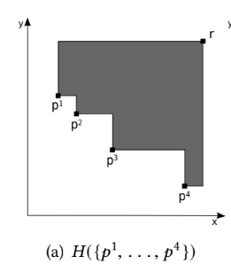
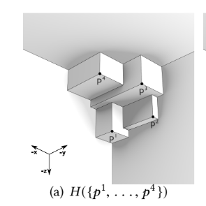

# Metric


## 1. Hàm mục tiêu

Trong mã nguồn hiện tại, chương trình hỗ trợ 2 mục tiêu:

1. **Makespan ($C_{\max}$)**: Thời gian hoàn thành công việc cuối cùng:
   $$C_{\max} = \max_{j} (C_j)$$
2. **Tổng độ trễ có trọng số (Total Weighted Tardiness - TWT)**:
   $$TWT = \sum_{j=1}^{n} w_j \cdot \max(0, C_j - d_j)$$

Cả hai cùng minimize. 

## 2. Các độ đo đánh giá

Trong study baseline, HV là độ đo Pareto chính trong từng lượt chạy. IGD+ và C(A,B)
dùng khi so hai thuật toán (hậu xử lý). Các chỉ số phụ: mục tiêu đơn lẻ, kích thước
archive, thời gian, kiểm tra khả thi/tái lập.

### 2.1. Hypervolume (HV)

HV đo **thể tích (độ đo Lebesgue)** của vùng trong không gian mục tiêu bị chi phối
bởi tập nghiệm không trội $A$, tính từ điểm tham chiếu $r$. Bài toán **minimize**
Makespan và TWT: điểm càng gần gốc càng tốt; $r$ nằm “xấu hơn” mọi điểm của $A$.

#### Định nghĩa

Với tập xấp xỉ Pareto $A = \{p^1,\ldots,p^{|A|}\} \subset \mathbb{R}^m$ và điểm
tham chiếu $r \in \mathbb{R}^m$ thỏa $p \prec r$ (mọi $p \in A$ trội nghiêm $r$
theo nghĩa minimize: $p_j \le r_j$ mọi chiều và ít nhất một chiều chặt):

$$
\operatorname{HV}(A, r) = \Lambda\left(
  \bigcup_{p \in A}
  \{ q \in \mathbb{R}^m \mid p_j \le q_j \le r_j,\; j = 1,\ldots,m \}
\right)
$$

trong đó $\Lambda$ là độ đo Lebesgue (diện tích khi $m=2$, thể tích khi $m=3$).

Với $m=2$, HV là diện tích hợp các hình chữ nhật
$[p_1, r_1] \times [p_2, r_2]$:

$$
\operatorname{HV}(A, r)
= \Lambda\!\left(
  \bigcup_{p \in A} [p_1, r_1] \times [p_2, r_2]
\right).
$$

Hình dưới minh họa HV 2 mục tiêu: vùng tô xám là $H(\{p^1,\ldots,p^4\})$ bị chặn
bởi front $\{p^i\}$ và điểm tham chiếu $r$ (góc trên-phải).




Với $m \ge 3$, cùng định nghĩa mở rộng thành hợp các orthotope; hình 3D minh họa
ý tưởng thể tích bị “bao” bởi $\{p^1,\ldots,p^4\}$:




**Ý nghĩa:** HV càng **lớn** càng tốt : phản ánh cả
hội tụ (front tiến sát biên tốt) và phân bố (phủ rộng vùng bị chi phối).

#### Chuẩn hóa và công thức trong code

Mục tiêu thô (Makespan, TWT) có đơn vị khác nhau. Trước khi tính HV, chuẩn hóa về
$[0,1]$ bằng cận **cố định theo dữ liệu** $L,U$ (không phụ thuộc kết quả chạy):

$$
f^{\mathrm{scaled}}_j
= \frac{f_j - L_j}{\max(U_j - L_j,\, 1)}
= \frac{f_j - L_j}{\mathrm{span}_j},
\quad j \in \{1,2\}.
$$

- $L,U$: từ `objective_bounds(instance)` — makespan theo đường công việc/tải máy;
  TWT dưới $=0$, trên conservative theo makespan serial + due dates.
- Mục tiêu cố định ($L_j = U_j$) → scaled $=0$; giá trị **ngoài** $[L,U]$ bị từ chối
  (không cắt ngưỡng).

Điểm tham chiếu trên không gian đã scale: $r = (1.1,\, 1.1)$. Báo cáo dùng **phân số
hộp tham chiếu** (khớp `normalized_hypervolume` trong
[`fjsp_experiments.py`](../vendor/moead_framework/tool/fjsp_experiments.py)):

$$
\mathrm{HV\_score}(A)
= \frac{\operatorname{HV}(A^{\mathrm{scaled}},\, r)}{r_1 \cdot r_2}
= \frac{\operatorname{HV}(A^{\mathrm{scaled}},\, (1.1, 1.1))}{1.1^{2}}.
$$

Như vậy $\mathrm{HV\_score} \in [0,1]$ khi mọi điểm scaled nằm trong $[0,1]^2$ và
bị $r$ bao. Đây **không** phải phần trăm đạt tối ưu lý thuyết.

#### Quy trình trong một study

- **Một seed:** HV tại các `checkpoints` (vd. 13, 250, 500, 1000 NFE) trên archive
  không trội → `initial_hv`, `final_hv`, `hv_gain`. Archive HV không được giảm giữa
  các mốc (`hv_monotonic`).
- **Nhiều seed:** `hv_mean ± hv_std`, `hv_gain_mean`; đồ thị `convergence.png`.
- So sánh HV chỉ có nghĩa trên **cùng instance**, cùng $L,U$ và cùng $r$.

### 2.2. IGD+ (Inverted Generational Distance Plus)

**Ý nghĩa:** IGD+ đo khoảng cách từ front tham chiếu tới front xấp xỉ — front càng sát và phủ tốt biên tham chiếu thì IGD+ càng nhỏ.

Sau khi có hai study, gộp `objective_vectors` mọi seed cả hai bên, lọc Pareto →
$P^*_{\mathrm{ref}}$ chung từng instance. IGD+ của một front $A$ (đã chuẩn hóa như HV):

$$
\operatorname{IGD+}(A, P^*)
= \frac{1}{|P^*|}
\sum_{p \in P^*}
\min_{a \in A}
d^+(p, a),
$$ 
Trong đó
$$
\qquad
d^+(p, a)
= \sqrt{\sum_{j=1}^{m} \max(a_j - p_j,\, 0)^2}.
$$

Chỉ phạt chiều mà $a$ **tệ hơn** $p$ (minimize). IGD+ càng **nhỏ** càng tốt.

### 2.3. C(A, B) — Set Coverage

**Ý nghĩa:** $C(A,B)$ cho biết A bao phủ (chi phối) bao nhiêu phần trăm nghiệm của B; càng gần 1 thì A càng chiếm ưu thế hơn B.

$$
C(A,B)
= \frac{
|\{ b \in B \mid \exists a \in A:\; a \preceq b \}|
}{|B|},
$$

với $a \preceq b$ là chi phối yếu ($a_j \le b_j$ mọi chiều). Báo cáo cả $C(A,B)$ và
$C(B,A)$ (tổng không nhất thiết bằng 1). Hàm: `set_coverage()`.

---

## 3. Cấu hình thực nghiệm 

File `baseline_validation.json` đóng vai trò là giao thức thực nghiệm chuẩn. Nội dung bao gồm:

- **Tham số thuật toán MOEA/D (`algorithm`)**:
  - `partitions = 12`: Lưới chia 12 đoạn cho bài toán 2 mục tiêu, sinh ra $N = 12 + 1 = 13$ vector trọng số (kích thước quần thể là 13).
  - `neighbors = 10`: Kích thước láng giềng $T = 10$ cho mỗi bài toán con.
  - `evaluations = 1000`: Ngân sách tối đa 1.000 lượt đánh giá hàm mục tiêu (NFE).
  - `crossover = 0.8`: Xác suất lai ghép ($p_c = 0.8$).
  - `mutation = 0.05`: Xác suất đột biến ($p_m = 0.05$).
- **Chiến lược kiểm chuẩn (`seeds`, `checkpoints`, `hv_reference`)**:
  - Chạy trên 10 seed độc lập: `[0, 1, 2, 3, 4, 5, 6, 7, 8, 9]`.
  - Lặp lại `repeat_seed = 0` để kiểm tra tính tất định và khả năng tái lập kết quả.
  - Các mốc checkpoint ghi nhận dữ liệu: `[13, 250, 500, 1000]` NFE.
  - Điểm tham chiếu chuẩn hóa tính HV: `[1.1, 1.1]`.

- **Tổng số lượt chạy**: 84 bài × 10 seed = 840 lượt chính + 84 lượt kiểm tra lặp lại = 924 lượt (924.000 NFE).

---

## 5. So sánh hai thuật toán MOEA/D gốc và cải tiến bằng độ đo IGD+ và C(A, B)

Script `scripts/compare_studies.py` thực hiện so sánh hậu xử lý giữa 2 study đã chạy xong.

### Cách dùng

```bash
python scripts/compare_studies.py \
    --study-a results/baseline/ \
    --study-b results/improved/ \
    --output  results/comparison/
```

### Yêu cầu đầu vào

- Cả 2 thư mục phải có cùng tập instance (kiểm tra khi load).
- Bounds của cùng instance phải khớp giữa 2 study (kiểm tra khi load).
- Mỗi thư mục cần có `manifest.json` với trường `bounds` và thư mục `runs/*.json`.

### Quy trình tính toán

1. `load_study()` — đọc manifest + từng run, dùng `read_case()` để kiểm tra integrity hash.
2. `build_reference_front()` — gộp `objective_vectors` cả 2 bên, lọc Pareto → $P^*_{\text{ref}}$.
3. `compare_instance()` — tính IGD+ per-seed, C(A,B) và C(B,A) trên Pareto front gộp theo bên.

### Kết quả xuất ra

| File | Nội dung |
|------|----------|
| `comparison.csv` | Tổng hợp per-instance: IGD+ mean/std, C(A,B), C(B,A), ref_front_size |
| `comparison.md` | Bảng Markdown đọc nhanh |
| `per_seed_igd_plus.csv` | IGD+ từng seed cho cả A và B |

### Verification tự kiểm (chạy A vs A)

```bash
python scripts/compare_studies.py \
    --study-a results/baseline_step6/ \
    --study-b results/baseline_step6/ \
    --output  results/comparison_selfcheck/
```

Kết quả mong đợi: `igd_plus_a_mean == igd_plus_b_mean` và `coverage_a_over_b == coverage_b_over_a` trên mọi instance.


